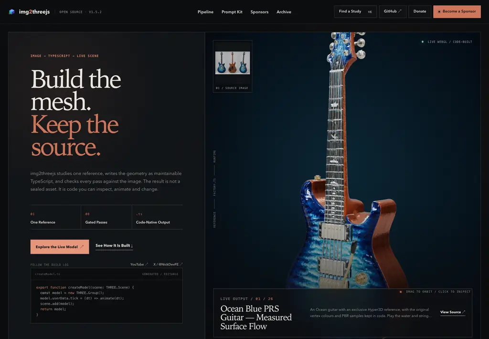
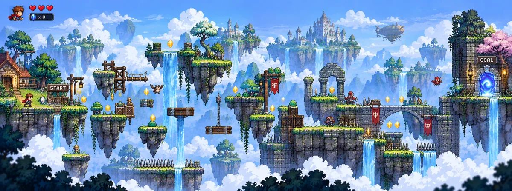
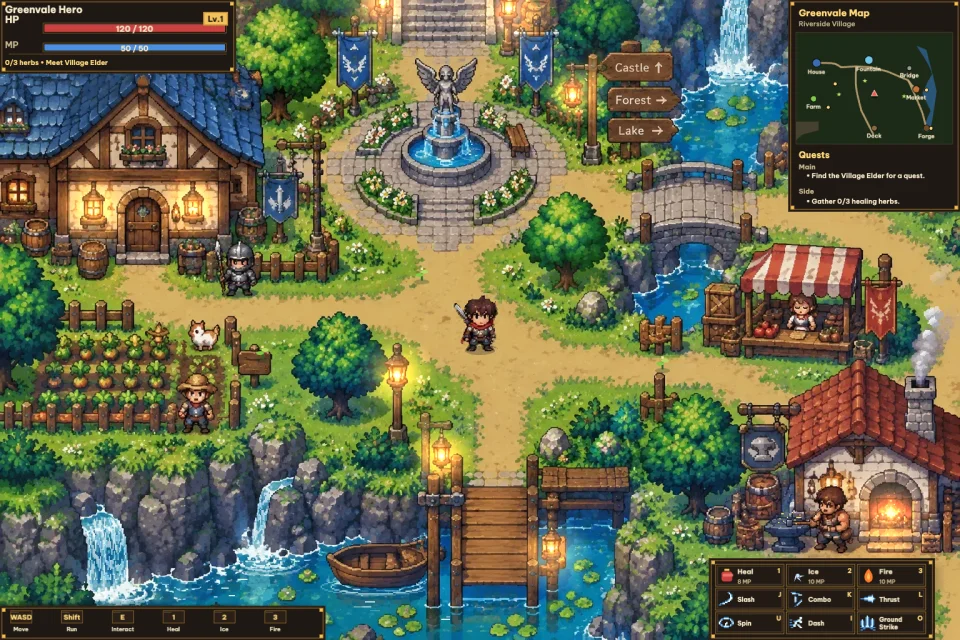
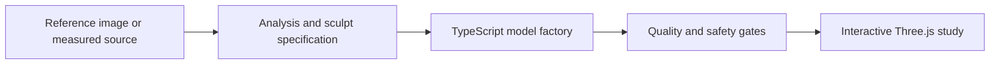
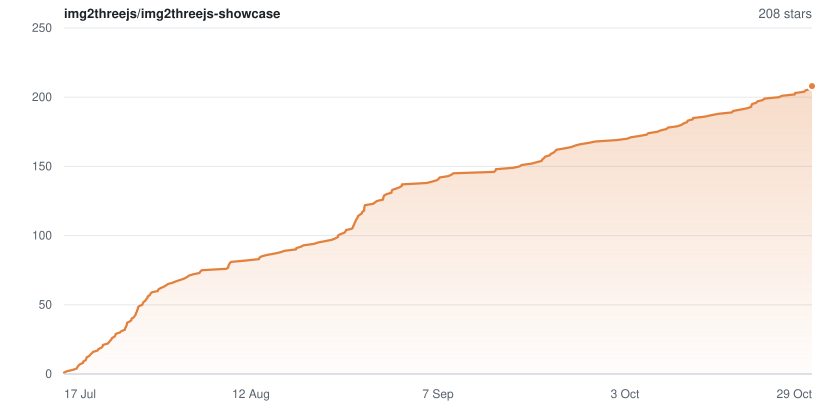

<div align="center">

# img2threejs Showcase

### Build the mesh. Keep the source.

Reference-led 3D studies rebuilt as inspectable, animation-ready Three.js code —
running live in the browser.

[](https://img2threejs.io/)
[](https://github.com/img2threejs/img2threejs)

[](https://github.com/img2threejs/img2threejs-showcase/stargazers)
[](https://github.com/img2threejs/img2threejs-showcase/actions/workflows/deploy.yml)
[](https://github.com/img2threejs/img2threejs-showcase/actions/workflows/pr-safety-check.yml)
[](https://threejs.org/)
[](https://github.com/img2threejs/img2threejs/releases)

<a href="https://img2threejs.io/">
  
</a>

<sub>Open a study, orbit the model, inspect its parts, trigger its actions, and follow the source back to the code.</sub>

[Gallery](https://img2threejs.io/) · [How it works](#from-reference-to-live-study) · [Contribute](#contributing-a-study) · [Develop](#local-development) · [Community](#community)

</div>

---

## Latest showcases and Interior

The landing page opens with **Latest showcases**, highlighting the three most recently
updated studies across Three.js, PixiJS and standalone experiences. The same `updatedAt`
ordering drives **04 / THE ARCHIVE** and Find a Study; the newest archive card is marked
**Latest Showcase**.

Use the **Interior** filter for img2interior rooms. **Living Room — Blender + Three.js**
opens the dedicated `/living-room/` viewer and is no longer listed under Objects.
Its thumbnail remains explicitly labeled **Design reference**, not a captured live render.
Existing `#/x/<id>` links still open the requested Three.js study directly.

## Skybound Adventure — playable pixel-art kingdom

Open **Skybound Adventure — The Floating Kingdom** in the home-page Archive, or
use the **2D Games** filter. The card displays the supplied **original reference
image**, not a gameplay screenshot; **Explore Skybound Adventure** opens the
standalone `/skybound-adventure.html` game.



Production-browser captures (PR evidence, not shipped game assets):
[gallery card](https://raw.githubusercontent.com/img2threejs/img2threejs-showcase/52cce2d0dd4f61342ab553a5c4104b0e29ec4388/public/skybound-adventure/showcase-card.webp) ·
[native-fullscreen gameplay](https://raw.githubusercontent.com/img2threejs/img2threejs-showcase/52cce2d0dd4f61342ab553a5c4104b0e29ec4388/public/skybound-adventure/showcase-fullscreen.webp).

The game fills the browser viewport without an inspector/sidebar. Begin requests
native fullscreen when supported; the fullscreen button or F toggles it and Esc
leaves it. Browsers that deny native fullscreen still get full-window gameplay.
Back to Showcase returns to the gallery.

- A/D or arrow keys move; Space jumps, double-jumps or wall-jumps; Shift dashes.
- Collect up to 13 crystals, activate checkpoints and reach the sky gate. Coins
  remain optional in ordinary play.
- Losses with hearts remaining respawn at the checkpoint without refilling those
  hearts. The last heart starts a fresh run after the death animation, resetting
  spawn, collectibles, enemies, checkpoint, moving platforms and run counters.
- Keyboard controls are required; touch movement controls are not implemented.
- `npm run test:skybound` runs the ported gameplay regression suite, including the
  all-13 route and exhausted-heart reset. `npm run build` includes the standalone page.

Implementation: [`src/demos/skybound-adventure/`](src/demos/skybound-adventure/).
Runtime layers and locally bundled Press Start 2P font:
[`public/skybound-adventure/`](public/skybound-adventure/).
The full supplied image is [`reference.png`](public/skybound-adventure/reference.png);
the archive WebP is a downscaled copy within the catalog's 800 KiB limit.

**Provenance and limits:** this is an experimental source-derived PixiJS raster
game, not a procedural Three.js model or a claim of recovered original layers.
Hidden artwork/support and actor animation are authored/inferred. Existing
background reconstruction limitations remain; the reference is not relicensed
by this port and redistribution rights require maintainer confirmation. The
bundled pixel font retains its license in the game's `fonts/` directory.

## Greenvale — img2pixi2D experiment

**Experimental img2pixi2D study; rendering and provenance limits remain documented below.**
This study ports the existing Greenvale 2D game into a standalone `/greenvale.html`
entry, alongside the existing standalone iPhone Duo page. It does not register a
Three.js model, modify the gallery router, or depend on the separate Moonlight Cafe PR.

```sh
npm ci
npm run dev -- --host 127.0.0.1
# Open /greenvale.html on the URL printed by Vite.
```

The home page Archive lists **Greenvale — Playable 2D Village** among its first
cards, with a **2D Experiment** label and an actual gameplay overview. Use the
**2D Games** filter or search for Greenvale/img2pixi2D; **Play the 2D Game** opens
the standalone page rather than a Three.js inspector.



The 960×640 WebP is captured from the running PixiJS scene, not the source
reference or a generated mockup. It is a runtime asset for the gallery card and
the standalone loading screen.

- A village-art loading screen appears from initial HTML, before the game module
  downloads. The same screen reports font, asset and renderer setup without fake
  percentages or an artificial delay. Pixel pulses respect reduced motion;
  module failures stop the animation, while boot failures reveal the retry alert.
- Native PixiJS 8.22.0 containers, source-derived sprite layers, editable actor rigs,
  native HUD text/graphics, lighting, water, smoke and skill VFX; no 3D runtime.
- WASD/arrows walk; Shift runs; E interacts. 1/2/3 cast Heal/Ice/Fire;
  J/K/L/U/I/O trigger Slash/Combo/Thrust/Spin/Dash/Ground Strike.
- Touch devices receive a joystick, hold-to-run, interaction and all nine skill buttons.
  The first click/tap requests fullscreen where supported; F toggles fullscreen,
  P pauses and R resets. No outer settings panel or header.
- The 1536×1024 artboard keeps its proportions. Portrait screens have substantial
  letterboxing; landscape touch controls can overlap the map.
- Landscape controls use translucent circles (24% button fill, 12% joystick fill),
  a larger Slash button, arc-arranged attacks and colored Heal/Ice/Fire symbols.
  Held controls brighten; keyboard badges are hidden in landscape. Touch targets
  remain at least 48px; portrait and desktop styling is preserved.

Implementation: [`src/greenvale/`](src/greenvale/).
Bundled artwork, runtime layer manifests and fonts:
[`public/greenvale/`](public/greenvale/).
The host owns the Pixi Application, ticker, input and resource lifetime;
`scene.ts` owns the reusable scene.

**Provenance and limits:** artwork derives from a user-supplied flattened Greenvale
reference. Hidden ground/joints and actor background plates are inferred, not recovered
original layers. Mirrored front-view poses are not true side/rear sprite sheets.
Attack effects are visual actions, not an enemy/damage combat system. Artwork is not
relicensed by this experiment; redistribution rights still require maintainer confirmation.
Bundled Be Vietnam Pro fonts retain their [SIL OFL](public/greenvale/fonts/OFL.txt).

**Runtime-only Greenvale files:** keep `greenvale.html`, `src/greenvale/`,
the three `public/greenvale/*/manifest.json` files, their referenced PNGs,
all bundled fonts with `OFL.txt`, and `public/greenvale/showcase-preview.webp`
for the gallery. The manifests retain source hashes and
inference notes. Build/local-server configuration and the dependency lockfile
remain required. Extraction masks, unused per-layer metadata, separate character
provenance, screenshots, verification reports and the Greenvale test harness have
been removed; gameplay and other showcase scenes are unchanged.

To check locally, open `/greenvale.html`, walk/run with WASD and Shift, try the
nine skill keys and resize to mobile landscape for the translucent controls.
Physical-device and Safari checks were not performed.
Runtime-only cleanup check: TypeScript passes; Chromium loads all 47 manifest
images and 12 font files, renders one canvas, and accepts all nine keyboard
skills. Walk/run move 25/47 pixels over four 0.05-second simulation steps driven
by native keyboard input. At 844×390, translucent controls render without page
overflow and the pointer Combo button invokes the Combo action.
Fullscreen is preserved: the first click enters browser fullscreen, F exits and
re-enters it, and Combo works while fullscreen is active. Chromium checks confirm
the stage fills both 1440×960 and 844×390 viewports, including mobile controls.
Browsers require a user gesture for fullscreen; where the API is unavailable,
the game still fills the browser viewport.
Gallery checks: the overview loads at 960×640 on desktop and mobile; counts are
33 total studies, 18 objects, 14 characters and one 2D game after integrating main.
Object/character
filters exclude Greenvale; search and the archive card both open `/greenvale.html`,
where a subsequent click enters fullscreen. No JavaScript errors were recorded
in those navigation checks.
After integrating the current main branch, the complete `npm run build` passes:
prebuild donation/iPhone/Tropical Island checks, TypeScript, Vite production
bundles, 30 portable Three.js source archives and the postbuild dist check.
The earlier source-ZIP traversal failure no longer occurs in this integrated
version; no build gate was skipped.


## About the showcase

This repository is the public gallery for [img2threejs](https://github.com/img2threejs/img2threejs).
Each study pairs its reference with a reviewable TypeScript implementation, catalog metadata,
and a live Three.js scene or a dedicated PixiJS 2D artboard. The result is not a sealed render:
it is code you can inspect, diff, animate, and extend.

<table>
<tr>
<td width="33%" valign="top">
<strong>Reference-led</strong><br><br>
Silhouette, proportions, materials, and visible details are measured against the supplied source.
</td>
<td width="33%" valign="top">
<strong>Code-owned</strong><br><br>
Runtime geometry and behavior live in the repository. Demo code cannot depend on remote meshes, CDNs, or network calls.
</td>
<td width="33%" valign="top">
<strong>Animation-ready</strong><br><br>
Named parts, pivots, rigs, contact pairs, and effects are authored for interaction rather than flattened into a single asset.
</td>
</tr>
</table>

The catalog keeps honest status metadata: **final** entries are completed reconstructions;
**placeholder** entries remain visible while their final rebuild is in progress. The live source
of truth is [`src/demos/registry.ts`](src/demos/registry.ts).

## Recent studies

| Study | What to explore |
| --- | --- |
| [Man Robot · Segment Color Studio](https://img2threejs.io/#/demo/man-robot-studio) | A source-preserving 65-joint robot with six color regions, rigged clips, an electric-green scan, and a WebGPU-first renderer with an automatic WebGL2 fallback. |
| [Tropical Island — code-only measured study](src/demos/tropical-island/createTropicalIslandModel.ts) | Ten force-measured TypeScript surfaces, procedural terrain/water/foliage, 27 selectable parts, and no runtime GLB or source texture maps. |
| [Moonlight Cafe — PixiJS 2D study](src/demos/coffee-house/scene.ts) | Source-derived café layers, ambient sky/water/boats, the approved seated cat with tail-only sway, and a collapsible description/reference panel at `#/demo/coffee-house`. |
| [Ocean Blue PRS Guitar](https://img2threejs.io/#/demo/prs-ocean) | Measured vertex color and PBR samples preserved in code, six addressable strings, and opt-in water-flow actions. |
| [Groot — Heart of the Forest](https://img2threejs.io/#/demo/monster-tree) | A navigable woodland scene with retargeted movement, grounded combat, living-wood effects, and lantern spirits. |
| [Mars Cat](https://img2threejs.io/#/demo/mars-cat) | Seventeen measured regions streamed at three quality levels without shipping the reference GLB, textures, or UV atlas. |
| [Starship + Super Heavy](https://img2threejs.io/#/demo/starship-super-heavy) | Procedural stainless shells, heat-shield tiles, flaps, grid fins, engine arrays, and a staged separation sequence. |

<div align="center">

[Browse every live study](https://img2threejs.io/#archive)

</div>

## Gallery snapshots

<table>
<tr>
<td width="50%" align="center" valign="top">
<a href="https://img2threejs.io/#/demo/sony-wf1000xm3"></a><br>
<strong><a href="https://img2threejs.io/#/demo/sony-wf1000xm3">Sony WF-1000XM3</a></strong><br>
<sub>Open the case, lift both earbuds, spin them through a full turn, and settle them back into place.</sub>
</td>
<td width="50%" align="center" valign="top">
<a href="https://img2threejs.io/#/demo/gerber-knife"></a><br>
<strong><a href="https://img2threejs.io/#/demo/gerber-knife">Gerber Paracord Knife</a></strong><br>
<sub>A stonewashed tanto profile, skeletonized tang, hex pommel, and woven orange cord.</sub>
</td>
</tr>
<tr>
<td width="50%" align="center" valign="top">
<a href="https://img2threejs.io/#/demo/doraemon-house"></a><br>
<strong><a href="https://img2threejs.io/#/demo/doraemon-house">Doraemon House</a></strong><br>
<sub>An isometric street diorama with layered roofs, overhead wires, a garden, and animated atmosphere.</sub>
</td>
<td width="50%" align="center" valign="top">
<a href="https://img2threejs.io/#/demo/warhauler"></a><br>
<strong><a href="https://img2threejs.io/#/demo/warhauler">War-Hauler “SECTOR 07”</a></strong><br>
<sub>A weathered six-wheel hauler with a riveted plow, reactor-lit hubs, and drifting exhaust.</sub>
</td>
</tr>
</table>

## From reference to live study



1. **Study the source.** Record visible proportions, silhouette, material behavior, and unknown depth.
2. **Build in code.** Assemble geometry, materials, named parts, and optional actions in a TypeScript factory.
3. **Measure the result.** Compare the render with the source, document inference, and iterate on the largest visible gaps.
4. **Publish the study.** Add catalog metadata and a local reference; CI builds the gallery and runs the static safety gate.

For the reconstruction workflow itself, start with the
[img2threejs repository](https://github.com/img2threejs/img2threejs).

## Contributing a study

Have an img2threejs model worth sharing? The repository includes a scaffold command and a
purpose-built contribution path.

```bash
git clone https://github.com/<your-user>/img2threejs-showcase.git
cd img2threejs-showcase
npm ci

git switch -c add-demo/<id>
npm run new-demo -- <id> "<Title>" object   # or: character

# Add the factory and reference, then complete the generated registry entry.
npm run build
node scripts/check-showcase-safety.mjs --base main
```

A submission must:

- for Three.js studies, build geometry in code without fetching remote meshes, textures, fonts or scripts;
  owner-reviewed source-derived PixiJS studies use the dedicated local-asset path documented below;
- include a catalog reference image you have the right to use (`.png`, `.jpg`, `.jpeg` or `.webp`, at most 800 KiB);
- use a kebab-case id unique across both catalogs and complete the selected renderer's required fields;
- set `status: 'final'` once the real implementation replaces the scaffold;
- pass both the production build and the same safety scan used by CI.

Read the full [contribution guide](CONTRIBUTING.md) before opening a pull request.

## Local development

### Requirements

- Node.js 20
- npm

### Commands

```bash
npm ci
npm run dev            # start Vite in development mode
npm run build          # run project checks, TypeScript, and the production build
npm run preview        # serve the production build locally
npm run new-demo -- --help
npm run star-history   # regenerate the chart below; requires GITHUB_TOKEN
```

The gallery uses hash routes (`#/` and `#/demo/:id`) so direct navigation remains compatible
with static hosting.

### Moonlight Cafe — dedicated PixiJS 2D demo

This checkout includes **Moonlight Cafe** at `#/demo/coffee-house`, discoverable in the
archive's Objects filter and the **Find a Study** command palette. It is an integrated gallery
demo, not a separate HTML entry or a Three.js group with invented camera metadata.

- `src/demos/coffee-house/` contains the production scene, animation modules and bundled
  layout/motion manifests. The source-derived mattes and hidden-background reconstruction
  remain authored approximations; this study does not claim artist-alpha reconstruction.
- `src/pixi/registry.ts` owns 2D metadata and runtime-selected renderer/artwork plugins.
  `src/pages/pixi-demo.ts` owns the hash-route shell and serialized atlas leases;
  `src/pixi/showcase.ts` owns the Application, uniform artboard fit, ambient clock and cleanup.
  The existing Three.js registry, cameras, inspector and exporters remain separate.
- Browser extensions are registered before Application initialization, with automatic
  extension imports disabled. Vite keeps Pixi in one lazy runtime chunk so the 2D
  route does not need a separate browser/worker environment fetch; 3D routes do not load it.
- The panel contains only the description and original reference. Desktop starts expanded;
  mobile starts folded. **Info / Hide**, Enter and Escape control it; folded content is inert
  and the expanded mobile panel scrolls independently. Reduced motion stops scene playback.
  Painting modes, Zoom/pan, Explore, part selection and 3D inspector/export tabs are absent.
- `public/coffee-house/motion-atlas.png` supplies every live scene texture. The original PNG
  at `public/coffee-house/reference.png` is shown in the reference panel; the gallery uses
  `public/references/coffee-house.webp` (189,598 bytes, below the 800 KiB catalog limit).
  Manifests are static imports; there is no direct factory `fetch` or external asset service.
  The full artboard and reference are not cropped.
- The scene exposes only its root, clock and disposal. It does not ship the source app's
  Original mode, selection markers or configurable effect controls, and does not load the
  separate original-mode atlas. Development screenshots and verification logs are not
  checked into the production contribution.
- Artwork redistribution rights still require maintainer approval. No public deployment
  or independent artwork-license verification is claimed.


### Tropical Island — code-only diorama

Open `#/demo/tropical-island`. The demo has 27 selectable parts, a coupled
shallow-water simulation, moored boat buoyancy, wind-driven foliage, a day/night
cycle and procedural fire, smoke and water-entry effects. Click/tap clear deep
sea to drop a rock, drag to orbit, and press **R** to repeat at the last water
point. Strong shore impacts extinguish the campfire; click its retained wood or
stone to relight it. Reduced motion holds the scene and disables physical drops.
Eligible, unobstructed water shows a gold aim cursor with a dark outline. Hover
uses the same depth, solid-prop, occupied-column and pool-capacity admission as
clicks. The native 32×32 SVG cursor has a centered hotspot, falls back to
`crosshair`, adds no animation loop, and clears on dragging, leaving the canvas,
blur or a click/**R** drop.

The ten prop surfaces in [`measured/`](src/demos/tropical-island/measured/)
follow the img2threejs force-measured route: u16 positions, octahedral 8+8-bit
normals, sampled vertex colors and lossless indices decoded into ordinary
Three.js geometry. These are surface buffers, **not a base64-wrapped GLB**.
Runtime uses no GLB/GLTF/BIN, GLTF/DRACO loader, source texture image or UV atlas.
The reference WebP is a gallery thumbnail, not a model texture.

[The measurement manifest](pipelines/tropical-island/measured-surfaces.json)
records source hashes, topology, transforms and sampling conventions. Across ten
source meshes, 708,881 vertices and 1,145,710 triangles retain their original
index order before the existing palm/fire cleanup. Independent local parity
checks measured maximum position error of `7.62939453125e-6` in source mesh
units and nonzero-normal error below `0.95°`.

**Fidelity limit:** base color is sampled at vertices; roughness and metalness
use measured sampled medians. Sub-vertex texture detail and source normal maps
are not retained, so this is not pixel-identical PBR texture shading.
Surface streams load asynchronously as 60 bounded TypeScript chunks before the
synchronous model factory runs. Raw positions, normals, sampled colors and
index order are preserved; the split removes the monolithic parser workload.
The complete island payload remains about 11.04 MB gzip. Build guards enforce
512 KiB runtime/metadata chunks, 300 KiB numeric chunks and 11 MiB aggregate gzip.
Vite receives an 8 GiB Node heap ceiling for full-gallery builds; this is not a
browser allocation or a quality setting.

**Numerical runtime.** MUSCL/HLL reconstruction and face fluxes use a generated
11,810-byte WebAssembly SIMD kernel with strict float64 arithmetic. Each water
instance owns its memory, and typed-array views avoid per-step copying.
Neighboring-cell foam lookups retain binary-search fallback for longer travel;
incident-wave dispersion is cached by exact depth. Regeneration uses the retained
C sources and `node pipelines/tropical-island/water-kernel/build-water-kernel.mjs`
(LLVM clang with wasm32 support and `wasm-ld` required). Normal builds use the
checked-in `waterKernelCode.ts`, with no compiler or external `.wasm` download.
Runtime requires WebAssembly SIMD and `DecompressionStream`.

Body and parcel sources now enter the field after every existing CFL substep,
before the next CFL scan. Contact sampling reads live water instead of the last
GPU upload; visual effects and texture uploads remain once per render frame.
This fixes uneven-frame feedback that could eject a submerged rock and make
the solver's CFL speed signal explode. The repeating schedule
`1/60, 0.05, 1/120, 0.026` seconds previously reached 31,784; the corrected real
scene completed 6.026 physical seconds with a maximum of 30.59 and a submerged
rock. Coastal-jitter and stale-contact regressions both failed before their fixes.
No geometry/effects were removed; no velocity clamp, FPS cap, simulation-clock
slowdown, LOD, decimation or busy worker was introduced.

**Verification.** All 95 island tests passed. With identical source scheduling,
116 frames across still water, incident waves, prescribed impacts and mixed
wet/dry lanes were byte-identical to the original solver across 16 fields.
Physical clocks, soil absorption and non-finite errors matched; four full-grid
foam-transport cases also matched, including long backtraces and signed zero.
The body-coupling fix deliberately changes source scheduling rather than
preserving the unstable trajectory.

**Process CPU measurement:** Chrome 154 / Apple M1 Metal, headless 1280×960 at
DPR 1, production assets, the same executable and a dedicated profile. Each
default-scene run lasted 40 seconds; values average the final 30 seconds.
CDP per-process CPU-time deltas use **100% for one CPU core**, not the whole
machine. No profiler, build or test job ran during capture.

| Measurement | Previous runtime | Optimized |
| --- | ---: | ---: |
| Total Chrome-process CPU | 107.4% | 79.8% |
| Renderer-process CPU | 85.6% | 57.7% |
| Main-thread occupancy | 81.2% | 52.6% |
| Observed FPS | 42.8 | 40.6 |
| Mean scene tick CPU per frame | 17.25 ms | 11.18 ms |

A trusted click and eight seconds of impact/settling averaged 84.0% total Chrome
CPU. These are measured workload results, not locked-60-FPS or other-hardware
guarantees. Browser checks covered sinking, boat response, fire extinction and
mesh-click relight, keyboard repeat, orbit cancellation, reduced motion, eligible
and blocked cursor states, full-pool rejection and native portrait touch.


`npm run build` checks island source/public assets before building and checks
`dist/` afterward. Focused physics and interaction regression tests:

```bash
node --test pipelines/tropical-island/*.test.mjs
npm run check:tropical-island
npm run build
```

The offline encoder and independent verifier are retained as code in
`pipelines/tropical-island/`. Regeneration requires Python 3 with Pillow and the
original GLBs under the gitignored `work/tropical-island/reference-models/`:

```bash
python3 pipelines/tropical-island/encode-surfaces.py
node pipelines/tropical-island/verify-surfaces.mjs
```

Normal builds do not need Python or the offline GLBs. Original models, temporary
state/specs, generation logs and historical QA images/videos are not part of
this showcase submission. Optional inspector GLB **export** remains available;
static exports do not bake the simulation, wind or volumetric effects.

## Download a showcase's Three.js source

Open a Three.js study, choose **Export**, then **Download source code** under
**Export a 3D Asset / From Stage**. The `<showcase-id>-source.zip` contains only
that showcase's runtime dependency graph, not the entire gallery. Source download
is independent of asset export scope, isolation and the current pose.

Man Robot Studio has these download controls in its component console. **Download GLB**
exports the robot alone (not the studio floor/lights); the format selector also offers
glTF, OBJ, STL, PLY and USDZ, and **Export all formats** bundles all six with a validation
manifest. GLB/glTF retain the source texture, current segment tints, 65-joint rig and
23 runtime clips. Static formats bake the visible pose with their stated material/rig
limits. Runtime scan shaders and gesture corrections remain in the source ZIP, not
the interchange files. Asset exports temporarily lock motion and painting, then
resume the existing playback state. Source download works before the model is ready.

Unlike GLB/glTF asset export, the source ZIP retains the original TypeScript factories,
all reachable quality/data modules, animation controllers, shaders, procedural VFX,
lighting and stage interaction hooks. Required textures and JSON assets are included;
their URLs resolve within the downloaded package, including after a subpath production
build. No `.glb`/`.gltf` model file or `GLTFLoader` dependency is allowed in these packages.
Static studies remain static: downloading source does not invent animation.

Each ZIP includes `package.json`, `manifest.json`, an executable browser example and
integration instructions:

```sh
npm install
npm run dev
# Production example:
npm run build
```

To reuse it, copy **both `src/` and `assets/`**, preserving their relative layout, into
a TypeScript-aware, asset-aware Three.js project. Install the ZIP's declared dependencies
and share a compatible Three.js instance with the host.

For standard Viewer-based packages:

```ts
import { mountShowcase } from './downloaded-showcase/src/index';

const asset = await mountShowcase(container);
const animation = asset.runtime?.animationController;
const action = animation?.actions[0];
if (action) animation.play(action.id);
// On unmount:
asset.dispose();
```

Use `createShowcase(scene)` for an existing scene and advance its `update(dt, elapsed)`
and `prepareRender()` from your own loop. Do not advance these again with `mountShowcase`;
its included Viewer already does so. Camera-dependent game interactions require the
included Viewer or an adaptation to the host engine. The package README explains both
integration paths and resource ownership. Existing provenance/attribution remains;
downloading does not grant new rights to third-party references or textures.

The Robot Studio package instead mounts its original component editor, motion library
and WebGPU/WebGL-fallback stage. `mountShowcase(container)` returns `{ dispose }`;
its controls own playback and painting. Use the exported robot model/animation APIs
when integrating into an existing scene. It includes the six robot runtime assets,
but omits the gallery's download panel to keep the standalone package free of
`GLTFLoader`.

Archives are generated from the selected registry entry and its actual imports by
`scripts/source-archives.mjs`. `npm run build` writes deterministic ZIPs to
`.release/showcase-sources/`, outside the Pages artifact. Only the small
`dist/source/index.json` catalog ships with Pages; development still generates
`/source/<id>.zip` on demand.

Production downloads use native browser attachments from a content-addressed
[GitHub Release](https://github.com/img2threejs/img2threejs-showcase/releases/tag/showcase-sources-54b5799f8fbb65a009d4b09e69296b64384b75b97b5f4300e18209cb2630c086),
not cross-origin `fetch`/Blob downloads: the release blob host does not provide
the CORS headers that flow needs. The catalog binds each showcase to its filename,
byte size, SHA-256 and immutable release URL. A source change produces a new tag;
there is no mutable `latest` download or manually maintained list of showcases.

The Pages workflow runs `npm run publish:source` **before** uploading its site
artifact. Publication verifies local bytes and server-side digests, resumes an
incomplete draft, reuses an identical published release, and refuses to overwrite
different published assets. Only the trusted deployment build receives
`contents: write`; PR builds generate and check packages without publishing.
For an authorized manual publication, build first, authenticate `gh` with release
write access, then run `npm run publish:source`.

`npm run build` also runs `npm run test:source` and rejects a Pages output larger
than 1,000,000,000 bytes. With the living-room study included, the verified output
is 959,790,635 bytes; its 30 procedural Source ZIPs (278,445,916 bytes) are hosted
on Releases instead. Runtime scene assets and visual quality are unchanged.
After building, validate all packages in isolated consumers with:

```sh
node scripts/check-source-archives.mjs
# Or specific studies:
node scripts/check-source-archives.mjs leesin tropical-island
```

## Repository map

```text
src/
  main.ts                 application bootstrap and route mounting
  content.ts              editorial copy for the gallery shell
  site-data.ts            canonical links, release, sponsor, and roadmap data
  pages/demo.ts           Three.js study viewer and information panel
  pages/pixi-demo.ts      dedicated PixiJS route shell and serialized asset lifecycle
  pages/workbench.ts      inspection and export workbench
  scene.ts                renderer, camera, controls, lighting, and disposal
  exporters.ts            browser-side export flows
  demos/registry.ts       Three.js catalog metadata and lazy runtime loaders
  pixi/registry.ts        PixiJS 2D catalog and runtime-selected plugins
  pixi/showcase.ts        PixiJS artboard, description/reference panel, clock and cleanup
  demos/<id>/             one implementation folder per study
public/references/         bounded local catalog reference images
public/coffee-house/       local café atlases and full original reference
scripts/
  new-showcase.mjs         contributor scaffold
  check-showcase-safety.mjs static pull-request safety gate
  generate-star-history.mjs repository-owned star chart generator
```

### Quality gates

Pull requests targeting `main` run the shared Node 20 quality workflow. The repository adds
showcase-specific checks for unsafe network access, reference formats and sizes, unique ids
across both renderer catalogs, and contribution boundaries. Merged changes are deployed automatically.

## img2interior — standalone living room

The archive card opens `/living-room/`: a Blender-authored room rendered in Three.js,
with PBR materials, baked ambient lighting, a shadowed sun, editable sofa finishes,
interactive curtains, reference comparison, and a collapsible Panel. This is not a
procedural img2threejs reconstruction. The synthetic Customuse reference is labelled
as a design image; Poly Haven materials/models are CC0, not the synthetic reference.

`showcases/living-room/` is an independent npm workspace pinning Three.js 0.180.0 and
Vite 6.4.1. The gallery keeps its existing dependency versions and procedural safety
rules. `npm ci` installs both dependency sets; Python 3 is also required.

- `npm run build` builds the child before the gallery. `build:living-room` uses Vite
  mode `showcase` and base `/living-room/`, writing generated files to `public/living-room/`.
- Before gallery development, run `npm run build:living-room`, then `npm run dev`.
  `npm run dev:living-room` runs the standalone viewer; `preview:living-room` serves
  its gallery build.
- Large binaries are pinned in `showcases/living-room/assets.lock.json`, fetched from
  the versioned [asset prerelease](https://github.com/img2threejs/img2threejs-showcase/releases/tag/img2interior-living-room-assets-v1),
  and verified against bundle and per-file SHA-256 checksums. They are not Git blobs.
- The Pages build contains runtime assets only. Source ZIP, portable GLB and packed
  Blender downloads point to the release, avoiding a duplicate half-gigabyte archive
  in Pages. They contain the original open-curtain / cream-sofa state, not live edits.
- Ordinary standalone `npm run build` keeps local downloads and includes all assets
  in its Source ZIP. The downloaded source is independently runnable.
- **Hide panel / Show panel** fills the browser viewport and preserves edits on
  desktop and narrow screens; it does not request operating-system fullscreen.
- `npm run sync:living-room -- --from <canonical-project>` explicitly refreshes viewer
  sources and manifest-declared assets. It preserves the gallery-specific publication
  adapter and requires matching dependency pins and the download override hook.

## img2interior — standalone modern bedroom

The Interior gallery card opens `/modern-bedroom/`. The 3D canvas fills the browser
viewport; the **Panel** button opens an overlay without resizing or resetting the
camera. The panel contains the overview, synthetic design reference, room-colour
customisation and source / portable GLB / editable Blender downloads.

- `showcases/modern-bedroom/` pins Three.js 0.180.0 and Vite 6.4.1.
- Run `npm run dev:modern-bedroom` for the standalone viewer, or
  `npm run build:modern-bedroom` before gallery development.
- `npm run build` builds both interior workspaces before the gallery.
- The runtime uses meshopt geometry, KTX2 textures/lightmaps and static lighting
  samples. Its versioned release bundle and individual files are SHA-256-pinned in
  `showcases/modern-bedroom/assets.lock.json`; binary assets are not Git blobs.
- Source, portable GLB and packed Blender downloads are separate release assets,
  not duplicated in the Pages output. The static exports do not capture live
  palette, curtain or throw changes. Baked indirect lighting does not rebounce
  when colours change.
- Dimensions and unseen surfaces are authored estimates from one synthetic
  reference, not measured reconstruction.

## Community

- [Discord](https://discord.gg/8DS8RTyuR) — feedback, reconstruction discussion, and work-in-progress studies
- [Issue tracker](https://github.com/img2threejs/img2threejs-showcase/issues) — gallery bugs and showcase submissions
- [YouTube](https://www.youtube.com/@hoainho1465) · [X / @NickDevFE](https://x.com/NickDevFE) — build logs and releases

## Support the project

img2threejs and this gallery are open source. If they save you time, you can support ongoing
work through [Ko-fi](https://ko-fi.com/iamnick) or the
[project donation page](https://img2threejs.io/donate.html).

## Star history

<div align="center">

<a href="https://github.com/img2threejs/img2threejs-showcase/stargazers">
  <picture>
    <source media="(prefers-color-scheme: dark)" srcset=".github/readme-assets/star-history-dark.svg">
    <source media="(prefers-color-scheme: light)" srcset=".github/readme-assets/star-history-light.svg">
    
  </picture>
</a>

<sub>Generated in-repository by <a href="scripts/generate-star-history.mjs"><code>scripts/generate-star-history.mjs</code></a> and refreshed daily.</sub>

</div>
